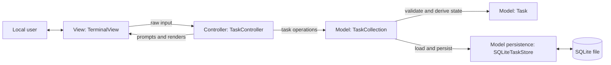
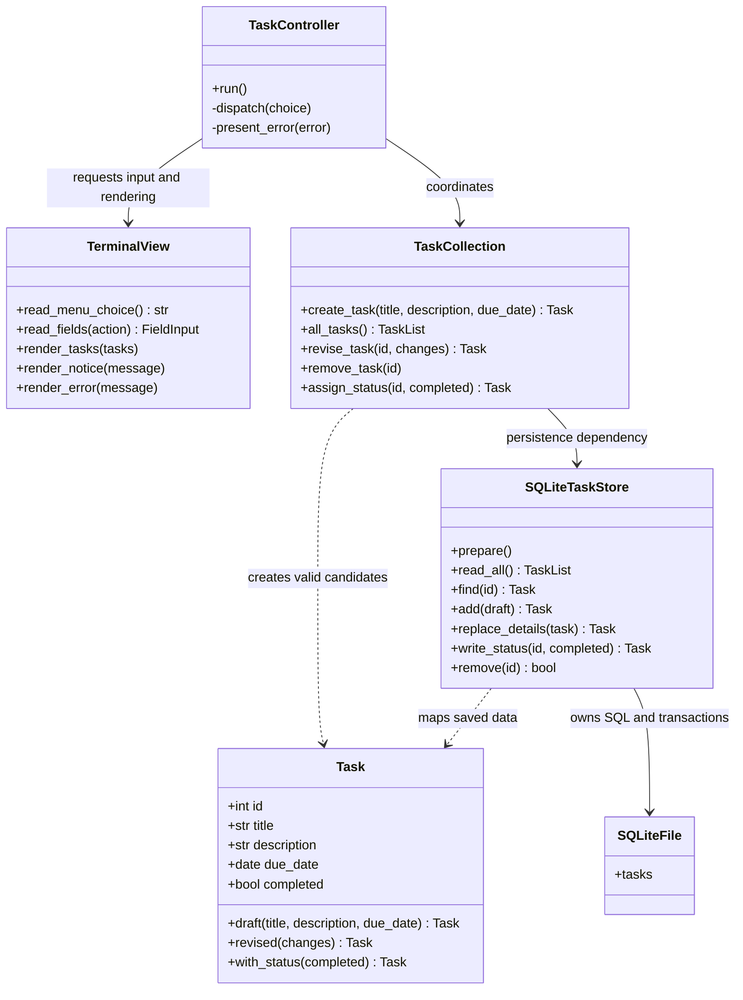
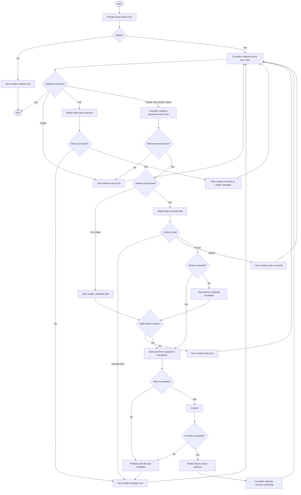

# Architecture B: Modular Model-View-Controller

**Date**: 2026-11-06 | **Status**: Proposed architecture; documentation only

## 1. Architecture Overview

This alternative is reasoned from the shared [requirements specification](../specs/001-task-management/spec.md)
and [project constitution](../.specify/memory/constitution.md). No Spec Kit commands were used
and Architecture A documents were not consulted in this generation. Both architectures share
the same requirements and required technologies; no empirical superiority is asserted here.

One Python process presents a local terminal menu to one user. MVC separates the interaction
cycle into a passive View, an application Controller, and a Model containing task behavior
and persistence. The Controller owns the command loop and chooses which View operation to call.
The Model never imports the View or Controller and never prints output.

The Model is internally modular: Task owns task invariants and produces valid replacement
values, TaskCollection provides task operations, and SQLiteTaskStore alone handles SQL. This
preserves the constitution's separation of UI, business logic, and database responsibilities
without moving rules into the Controller or combining SQL and validation in an active record.

Python 3.12+ is a proposed baseline, with standard-library sqlite3, datetime, dataclasses,
unittest, and tempfile. No framework, network service, account system, or third-party package
is required. The operating environment must provide Python with sqlite3 support and writable
local storage. This is a design choice, not a claim about installed software.



No observer bus or automatic model-to-view notification is required. The Controller explicitly
renders each result. No runtime application artifacts are produced by this documentation.

## 2. Component Responsibilities

| Component | Responsibility | Boundary |
| --- | --- | --- |
| TaskController | Own loop; dispatch menu actions; convert selection/status syntax; call Model; select messages | No task normalization, date rules, SQL, or direct terminal I/O |
| TerminalView | Read menu choices and requested fields; render complete task entries and errors | No Model/store access and no business validation |
| Task | Validate task fields; normalize title; create valid revised copies; explicit completion transitions | No database or terminal dependencies |
| TaskCollection | Expose five operations; load selected Task; apply entity behavior; save candidate; classify missing tasks | No presentation formatting or SQL |
| SQLiteTaskStore | Initialize store; read/map/write rows; bind SQL; own transaction and connection lifecycle | No task policy or user-facing messages |
| Startup composition | Supply selected database path, construct objects, start Controller | Wiring only; not another business layer |

Task is immutable by design. Editing returns a candidate Task instead of mutating a live object.
TaskCollection returns that candidate as saved only after persistence commits. There is no
persistent in-memory task cache to reconcile after a failed write. The store returns complete
saved entities; values are never represented as raw SQL rows outside the storage boundary.

### Conceptual Module Organization

Proposed only, with no source files created:

```text
task_app/
  main.py
  controller.py
  view.py
  model/
    task.py
    collection.py
    sqlite_store.py
    errors.py
```

The Model's business modules can be tested with a fake store. Constructor injection is sufficient;
no plugin system, abstract class hierarchy, or dependency injection framework is needed.

## 3. Data Flow and Interaction Contracts

Menu options are Create, View All, Edit, Delete, Set Status, and Exit. View shows task identity,
full title/description, due date as YYYY-MM-DD, and completed/incomplete status. Completed tasks
remain listed. Identity selects the target even when titles are identical. Listing uses identity
order for repeatability; the specification does not prescribe ordering.

| User action | Controller coordination | Model behavior | View result |
| --- | --- | --- | --- |
| Create | Request title, description, due date | Task validates; collection inserts an incomplete candidate | Saved identity and values, or field/storage error |
| View all | Request collection snapshot | Store reads all; collection returns immutable Task values | Every task once, or genuine empty-state message |
| Edit | Request identity and explicit field changes | Load; derive valid revised Task; store details only | Saved changes with id/status preserved |
| Delete | Request identity | Load/check; delete selected row | Deletion acknowledgement after commit |
| Set status | Request identity and explicit status choice | Load; derive requested state; store status only | Resulting status after commit |

Controller calls `create_task`, `all_tasks`, `revise_task`, `remove_task`, or `assign_status`
on TaskCollection. It supplies raw information strings, a positive integer identity when
needed, and a boolean status after converting an explicit terminal choice. TaskCollection
also rejects invalid identity/status argument types independently of terminal parsing.

Edit prompts ask which fields to replace. Omitted fields keep their values; selecting description
for replacement permits an empty value. An empty replacement title/date is invalid. Unknown
edit fields are rejected so identity/status cannot be changed through information editing.
An edit with no selected replacements returns the unchanged task and a no-change message.
Setting an already selected status succeeds idempotently, never toggling it.

### Boundaries and Error Outcomes

- Entity factory/revision methods raise FieldError with a field name and explanation.
- TaskCollection raises TaskMissing when a selected identity is absent. The store also reports
  a no-match write so an absent task cannot be acknowledged as updated or deleted.
- Store errors become StorageUnavailable at the Model boundary. Read failure cannot become
  an empty list. Invalid stored rows are storage errors, not corrected silently.
- Controller translates Model errors to safe View messages: invalid title/date, task not found,
  unable to load tasks, or unable to save changes. Raw SQL and filesystem details are hidden.
- Startup storage failure displays an error and ends the program. Recoverable action failures
  return to the menu. Cancelled/unsubmitted input never calls a Model mutation.
- Success rendering occurs only after the Model returns a committed outcome. Failed candidates
  are discarded; previously saved records remain unchanged under normal recoverable failures.

### Example: Editing a Due Date

View reads the identity and replacement text at the Controller's request. Controller asks
TaskCollection to revise that task. Collection loads the Task through SQLiteTaskStore, asks
Task to derive a copy with the new date, and passes valid details to the store. The store
commits before returning the saved value. Controller then tells View to render success.
A nonexistent task stops before entity revision; invalid date stops before writing; write or
commit failure stops before success. Other tasks and the selected task's status are preserved.

## 4. Database Design

See [database-design.md](database-design.md) for columns, mapping, state transitions, transaction
ownership, initialization, and validation rules. All SQL remains inside the Model's store module.

## 5. UML Class Diagram

Conceptual UML in Mermaid, not implementation signatures. TaskList is a collection of Task
values. Store reads/replacements may return absence as explained above. Only the collection
publishes saved results to the Controller.



Draft Tasks have no identity until inserted; saved Tasks have positive immutable identities.
The diagram's id field denotes the saved form. Task's methods return copies, not in-place
mutations. View has no reference to Model, and Model has no reference to Controller/View.

## 6. UML Activity Diagram

Mermaid flowchart syntax represents UML activity-style actions, decisions, start/end, and
loops. It is an activity-style diagram rather than native UML activity notation.



Store connections close on all outcomes. Empty edit is a checked no-op returning to the menu
without a write; same-status requests may use an idempotent status write. These shortcuts are
omitted from the diagram to keep the main command lifecycle readable.

## 7. Testing Strategy

See [testing-strategy.md](testing-strategy.md) for entity, Model, Controller, View, database,
and acceptance checks. All checks are proposed; no application tests have run.

## 8. Advantages and Disadvantages

| Evaluation criterion | Advantage supported by this design | Disadvantage or cost |
| --- | --- | --- |
| Simplicity | One process and three recognizable MVC roles | Model contains several modules; MVC is more structure than a script |
| Modularity | View and Controller are separate; storage is internal to Model | Poor discipline could still let Controller absorb business rules |
| Readability | Interaction policy is visible in Controller; Task expresses invariants | Understanding one action requires following several components |
| Maintainability | Task changes need not alter terminal rendering or SQL orchestration | Changing Model contracts may require Controller and store updates |
| Testability | Entity rules need no UI/database; Controller accepts fake View/Model | Tests require several small collaborators and real-store checks |
| Basic security | Valid candidates, bound SQL, safe error messages | No access control against people who can read the local file |
| One-student effort | Standard library; no web stack, event bus, or ORM | Additional boundary tests and immutable-copy handling take effort |

These are qualitative consequences of the proposed structure. No performance measurements,
rankings against Architecture A, or user satisfaction claims have been produced.

## Requirement and Constitution Review

| Requirement | Design coverage | Verification target |
| --- | --- | --- |
| FR-001 | Task draft incomplete; store assigns identity | Create and duplicate-value cases |
| FR-002 | Task title normalization; preserved description | Whitespace, empty and exact-description cases |
| FR-003 | Task date validation | Shape, calendar, leap-day and past-date cases |
| FR-004 | all_tasks and full View rendering including id | Mixed statuses, duplicate titles, 100 records |
| FR-005 | Read-only list and genuine empty message | Empty/repeated listings |
| FR-006 | revised copy; details-only persistence | Partial/combined edits, stable id/status |
| FR-007 | remove selected identity | Only selected row deleted |
| FR-008 | with_status and status-only persistence | Both directions and repeated assignment |
| FR-009 | Candidate validation before write | Invalid create/edit leaves all rows unchanged |
| FR-010 | Model lookup and store no-match checks | Missing id for edit/delete/status |
| FR-011 | SQLite file, committed changes | Reopen after all mutation types |
| FR-012 | Commit before saved result; rollback/errors | Read/write/commit failures |
| FR-013 | Entire MVC loop local, no credentials | Offline five-operation walkthrough |

Constitution compliance: UI, business behavior, and storage are identifiable modules even
though business and persistence both belong to MVC Model. Python/SQLite are retained. Task is
the single owner of field rules; store uses parameterized SQL. Unit testing avoids production
data. The five operations and seven evaluation criteria are covered with one-student scope.
No constitutional exception is required. This documentation does not complete runtime success
criteria or the final comparative evaluation.
