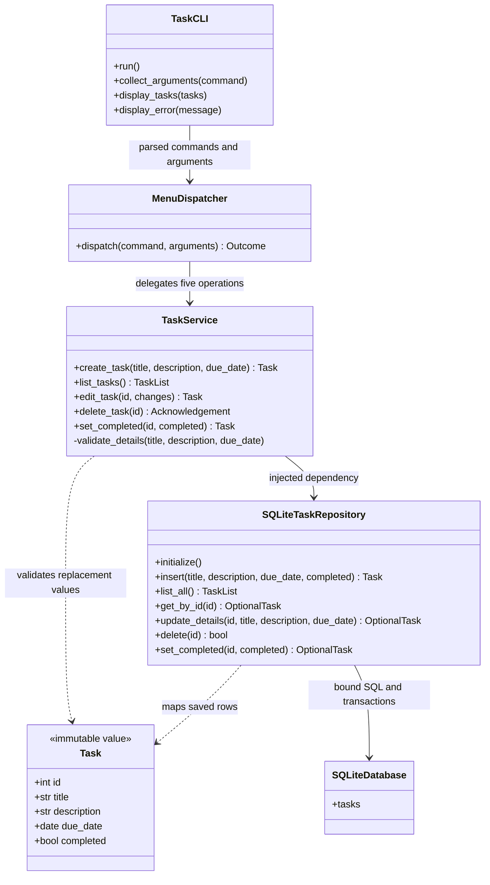
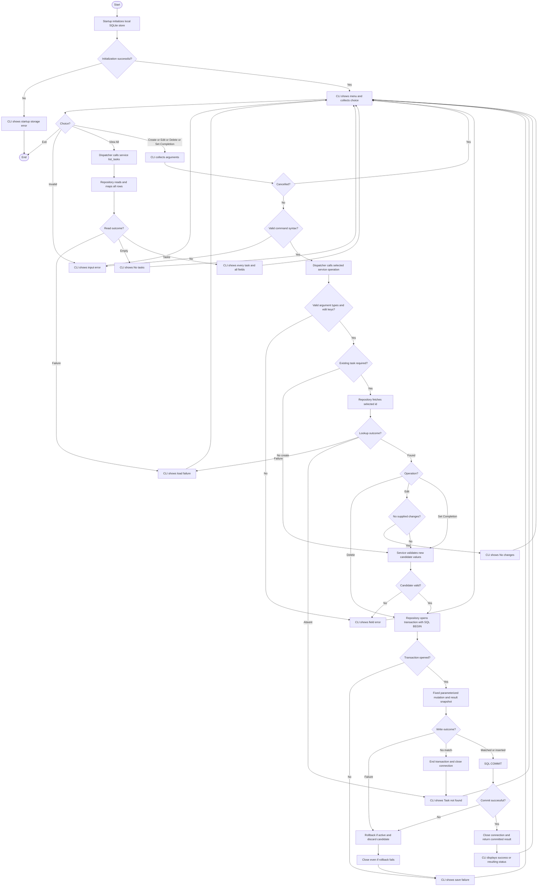

# Consolidated UML diagrams

Date: 2026-11-07. Conceptual design only; method contracts are defined in
[final design](final-design.md). Mermaid source is provided; rendered output is not verified.
The activity diagram uses Mermaid flowchart notation for UML-style actions and decisions.

## Class diagram

TaskList means a list of immutable Task snapshots. OptionalTask means Task or None.
Dispatcher and CLI are both in the presentation layer; startup composition is omitted.

Only SQLiteTaskRepository owns SQL. Task has no validation/persistence methods.
A creation candidate has no saved identity and is not the saved Task depicted here.
Failure outcomes are specified in the contracts rather than modeled as extra layers.

## Activity diagram

All reads close connections on success and failure. Beginning a transaction unsuccessfully
also closes the connection; no-match cleanup failure follows the storage-error path.
Same-status assignment follows the matched write/commit path. Delete requires no replacement
details; candidate validation remains in TaskService for create/edit/status.
