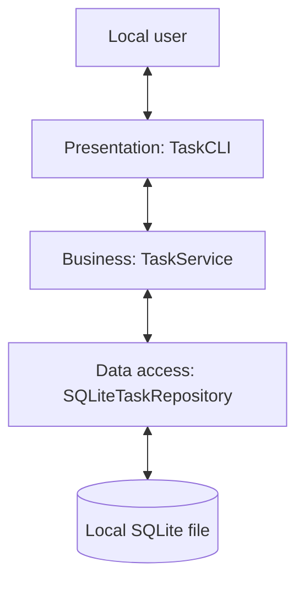
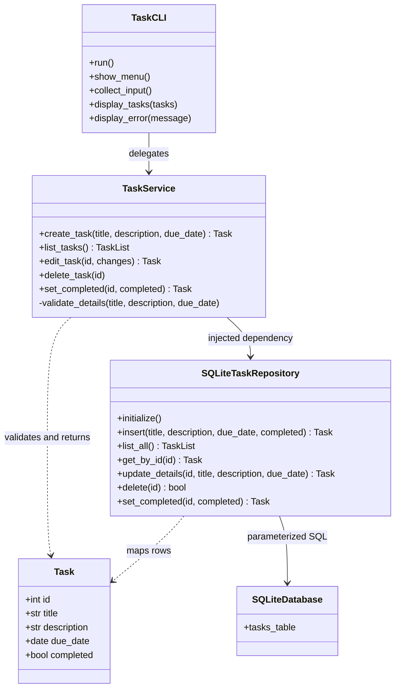
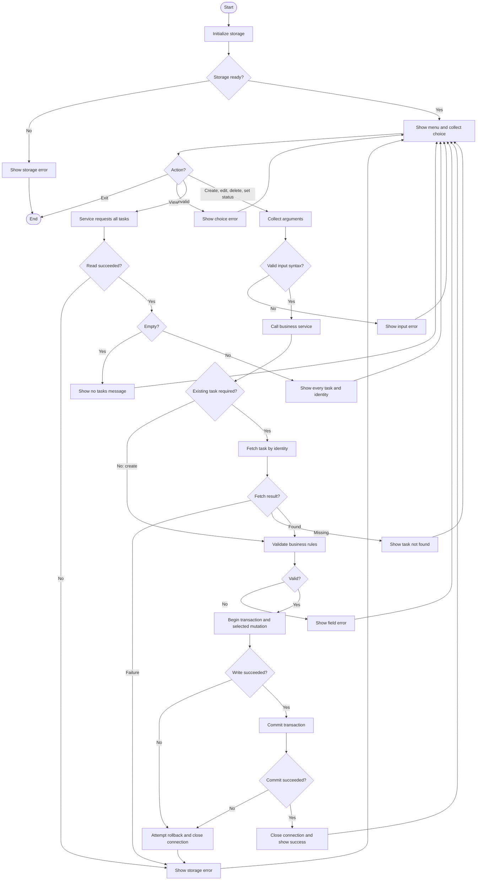

# Architecture A: BASE Three-Layer Architecture

**Date**: 2026-11-06 | **Baseline**: [spec.md](spec.md), project constitution v1.0.0

## Architecture Description

One local Python process runs an interactive terminal menu. Presentation handles interaction,
business logic owns task rules, and data access owns SQLite. Calls travel down the layers;
Task values and classified failures return upward. All interactions are synchronous and offline.

## Component Responsibilities

| Component | Responsibilities | Excluded responsibilities |
| --- | --- | --- |
| Startup | Resolve database path, compose components, initialize store, start UI | Business rules and SQL |
| TaskCLI | Menu, prompts, syntactic id/status conversion, rendering fields/messages | Direct repository access and business validation |
| TaskService | Validate/normalize fields; defaults; merge edits; missing-task checks; orchestrate five actions | SQL, connections, terminal I/O |
| Task | Carry id, title, description, calendar due date, completed boolean | I/O and persistence methods |
| SQLiteTaskRepository | Bound SQL, row mapping, identity generation, transactions, connections | Prompts and authoritative field validation |
| Failure types | Distinguish invalid input, missing task, persistence failure | Exposing raw SQL errors to the user |

The service receives a concrete repository through its constructor. Tests may inject a small
compatible fake. Task is a passive domain value object with no dependency on the service or
repository, so row mapping does not create a circular module dependency. Startup composition
is not a fourth business layer. UI cannot bypass the service; service cannot access SQLite directly.

## Data Flow Between Layers

| Operation | UI -> service | Service -> repository | Result |
| --- | --- | --- | --- |
| Create | title, description, date text | Validate; insert with completed false | Committed Task with generated id |
| View | list request | Read all ordered by id | All Tasks or real empty list |
| Edit | id and explicitly supplied changes | Fetch; merge and validate; update details | Committed Task, identity/status preserved |
| Delete | id | Check existence; delete by id | Committed acknowledgement |
| Set completion | id, explicit boolean | Check existence; assign status | Committed Task, details preserved |

The repository converts SQLite rows to Tasks, ISO date text to calendar dates, and 0/1 to
booleans. The UI displays full fields, identity, YYYY-MM-DD dates, and status words. All changes
target identity, never title. Edits distinguish omitted fields from an explicitly empty
description; blank replacement title/date is invalid. Same-status assignment never toggles.

### Error and Transaction Flow

Service validation precedes persistence. Missing records become TaskNotFoundError; repository
writes also check row matches so absence cannot appear successful. One active application
instance is assumed, so fetch-then-write needs no additional concurrency architecture.

Each repository mutation opens a connection with `autocommit=True` and uses explicit SQL BEGIN,
COMMIT, and ROLLBACK, as detailed in [research.md](research.md). Commit must succeed before the
service returns success. Write/commit failure triggers rollback when possible and connection
closure; read failures are never disguised as empty lists. Error messages distinguish field,
missing-task, and storage failures without printing raw SQL or paths. No cached task mutation
or success is published before commit.

Initialization creates a fresh store without resetting existing records. Initialization failure
shows a storage error and ends startup; action failure returns to the menu. Connections close
on all paths. Normal recoverable failures preserve previously committed data; physical device
failure recovery is outside scope. No network, background worker, ORM, or multi-user scheme.

## UML Class Diagram

Conceptual UML in Mermaid. TaskList means a list of Task objects. Repository get/update/status
operations may return no match as defined in [contracts](contracts/interfaces.md).

## UML Activity Diagram

Mermaid flowchart syntax expresses UML activity-style actions, decisions, loops, and start/end
nodes; Mermaid has no native UML activity notation. This covers the complete menu lifecycle.

For delete, validation checks identity/existence, not new task fields. A same-status request
may perform an idempotent status assignment. An empty edit returns the existing task without
a write and reports no change. The diagram summarizes these successful paths.

## Requirement Traceability

| Requirement | Design responsibility | Planned verification |
| --- | --- | --- |
| FR-001 | Service defaults; repository identity | Create, duplicates, default status |
| FR-002 | Service title normalization and text rules | Blank/whitespace title; empty/preserved description |
| FR-003 | Service strict shape and calendar validation | Leap days, malformed/impossible/past dates |
| FR-004 | Repository list; UI every field/id | Mixed status, duplicate titles, 100 tasks |
| FR-005 | UI empty state; read-only repository list | Empty and repeated listings |
| FR-006 | Service merge; repository details-only update | Individual/combined edits; unchanged identity/status |
| FR-007 | Repository id-targeted delete | Only selected task removed |
| FR-008 | Explicit boolean; status-only update | Both directions and repeated status |
| FR-009 | Validate before writes | Invalid create/edit leaves saved data unchanged |
| FR-010 | Service and repository no-match handling | Absent id for edit/delete/status |
| FR-011 | File storage and committed mutations | Reopen after every mutation type |
| FR-012 | Error translation, rollback, success after commit | Read/write/commit faults and saved-data snapshots |
| FR-013 | All components local | Offline walkthrough without login |

## Tradeoffs for Later Comparison

| Criterion | Architecture A evidence | Limitation/cost |
| --- | --- | --- |
| Simplicity | One process, three layers, standard library | CLI is less visual than a form |
| Modularity | Named boundaries and constructor injection | Concrete repository remains at composition |
| Readability | Five explicit operations, passive Task | More files than one script |
| Maintainability | One owner for business rules | Remote/concurrent use would need redesign |
| Testability | Business fake, simulated UI, real temporary store | Fakes cannot prove SQL behavior |
| Basic security | Validation, bound SQL, safe errors | Local file access remains an OS responsibility |
| One-student effort | No external infrastructure or packages | Menu interaction and validation still require care |

These are design tradeoffs, not measured scores or a comparison with Architecture B.
